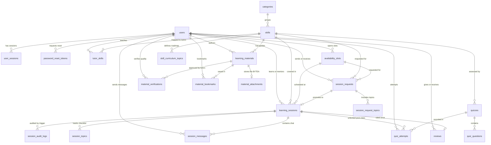

# PeerLearn 🎓

> **Learn one skill, teach another.**  
> A full-stack peer-to-peer skill exchange platform powered by **React + Spring Boot + PostgreSQL (RDBMS)**.

---

## 🛠️ Tech Stack

- **Frontend:** React 18, Vite 5, Tailwind CSS v3, React Router v6, Lucide Icons
- **Backend:** Java 17+, Spring Boot 3.3, Spring Web, Spring Data JPA, Spring Security + JWT (BCrypt), Spring Mail, **Flyway**
- **Relational Database (DBMS):** **PostgreSQL 14+**

---

## 🔐 Secure Authentication, Password Reset & Session Persistence

- **BCrypt Password Hashing & Welcome Email:** Local email/password accounts hash passwords with BCrypt before persisting to PostgreSQL `users`. New registrations asynchronously trigger a Welcome Email via `EmailNotificationService` when Gmail SMTP is configured (or log in dev console).
- **Forgot & Reset Password Flow:** Generating a password reset creates a single-use, 30-minute expiring token in `password_reset_tokens` (`POST /api/auth/forgot-password`). Submitting a new password (`/reset-password` → `POST /api/auth/reset-password`) marks the token as used and automatically revokes all active JWT sessions in `user_sessions`.
- **One-Click Demo Access:** Demo sign-in (`POST /api/auth/demo`) uses the persisted Hannah student/tutor account in PostgreSQL so every showcase booking, quiz, and session write hits the live database.
- **PostgreSQL Session Store (`user_sessions`):** Every login records a unique JWT `jti`, IP address, browser/device, login method, and expiration. Signing out or revoking a session sets `revoked = TRUE` so `JwtAuthFilter` immediately rejects revoked tokens.

---

## ✨ Platform Capabilities

- **Low-Cost INR Pricing (`₹`):** Affordable peer session fees in INR (`₹69–₹149/hr` defaults; tutors can customize `hourly_fee_inr` per skill in **My Teaching Skills**, snapshotted onto `session_requests` and `learning_sessions`).
- **Post-Class Topic-Matched Quizzes:** Marking a class as `Completed` unlocks a **Post-Class Topic Quiz** prioritizing `quiz_questions` matching the session's covered `session_topics`, recording results in `quiz_attempts.session_id` for both student and tutor visibility.
- **Skill-Aware Booking Requests:** Requesting a tutor dynamically filters checklist topics per selected skill (`topicsBySkill`) and accepts an optional note to the tutor.
- **Tutor Search & Discovery:** Search tutors by name, bio, or skill and clear active `?skill=` query filters with one click.
- **Interactive Learning Hub Reader & File Uploads:** Upload study documents, PDFs, slides, spreadsheets, and images (up to 10MB stored in PostgreSQL `material_attachments` as `BYTEA`), inspect/preview attached images, PDFs, and notes in a dedicated review modal before approving quality (`material_verifications`), edit existing tutor contributions, or publish real multiple-choice **Quiz Questions** persisted to `quizzes` and `quiz_questions`.
- **Live Session Sync & Video Links:** Accepted bookings automatically reject competing requests for the same slot and generate a Jitsi meeting room URL (`https://meet.jit.si/peerlearn-...`). Tutors can customize meeting URLs inline, and session views auto-poll every 4 seconds for near-real-time chat messages and checklist updates.

---

## 🗄️ Relational Database Architecture (3NF + Flyway Migrations)

The database schema is normalized to **3NF** across **22 relational tables** and version-managed with **Flyway**:

- [`V1__initial_schema.sql`](backend/src/main/resources/db/migration/V1__initial_schema.sql) — Base 18-table relational schema
- [`V2__dbms_enhancements.sql`](backend/src/main/resources/db/migration/V2__dbms_enhancements.sql) — Idempotent enhancements adding `password_reset_tokens`, `session_audit_logs`, triggers, stored function, partial index, and GIN full-text indexes (`baseline-on-migrate=true`, `baseline-version=1` for seamless adoption on pre-existing `peerlearn` databases)
- [`V3__material_attachments.sql`](backend/src/main/resources/db/migration/V3__material_attachments.sql) — Adds document/image attachment metadata on `learning_materials`, `material_attachments` (`BYTEA`), and unique per-tutor quality approvals in `material_verifications`
- [`V4__pricing_and_session_quizzes.sql`](backend/src/main/resources/db/migration/V4__pricing_and_session_quizzes.sql) — Adds affordable INR fee columns (`base_price_inr`, `hourly_fee_inr`, `fee_inr`), `quiz_attempts.session_id`, and topic-tagged quiz questions across core skills
- [`backend/database/schema_postgres.sql`](backend/database/schema_postgres.sql) — Full standalone reference DDL

### DBMS Features Highlight

- **Audit Trail & Triggers:**
  - `trg_mark_slot_booked_on_accept` automatically marks `availability_slots.is_available = FALSE` when a `session_requests` row transitions to `ACCEPTED`.
  - `trg_audit_session_changes` logs every `learning_sessions` creation and status change (`UPCOMING` → `COMPLETED` / `CANCELLED`) into `session_audit_logs`.
- **PostgreSQL Stored Function:**
  - `fn_reject_conflicting_requests(tutor_id, slot_id, accepted_request_id, reason)` atomically rejects competing `PENDING` bookings in PostgreSQL when a tutor accepts a slot.
- **Views & Specialized Indexes:**
  - `vw_tutor_ratings` aggregates tutor average ratings and review counts.
  - **Partial Index:** `idx_pending_slot_requests` indexes `session_requests(slot_id) WHERE status = 'PENDING'`.
  - **Full-Text GIN Indexes:** `idx_skills_fts` (on `skills`) and `idx_materials_fts` (on `learning_materials`) using `to_tsvector('english', ...)`.

### Entity-Relationship Diagram (22 Tables)



---

## 🚀 Getting Started

### 1. PostgreSQL Database Setup

1. Open **pgAdmin** or **psql** and create the database:
   ```sql
   CREATE DATABASE peerlearn;
   ```
2. Update your PostgreSQL username & password in [`backend/src/main/resources/application.properties`](backend/src/main/resources/application.properties):
   ```properties
   spring.datasource.username=postgres
   spring.datasource.password=YOUR_POSTGRES_PASSWORD
   ```
3. On startup, Flyway runs `V1__initial_schema.sql` and `V2__dbms_enhancements.sql` automatically (`baseline-on-migrate=true`, `baseline-version=1` preserves any existing tables/data safely).

---

### 2. Optional: Gmail SMTP (Welcome Email on Register & Password Reset)

Create git-ignored `backend/src/main/resources/application-local.properties` (automatically imported by [`application.properties`](backend/src/main/resources/application.properties)):

```properties
spring.mail.host=smtp.gmail.com
spring.mail.port=587
spring.mail.username=yourgmail@gmail.com
spring.mail.password=YOUR_16_CHAR_GMAIL_APP_PASSWORD
app.mail.from=yourgmail@gmail.com
```

*(When `spring.mail.host` is unset, welcome & reset emails are safely logged to the Spring Boot console.)*

---

### 3. Run the Spring Boot Backend & React Frontend

**Backend:**
```bash
cd backend
mvn spring-boot:run
```

**Frontend (new terminal in project root):**
```bash
npm install
npm run dev
```

Open [**http://localhost:5173**](http://localhost:5173) in your browser.
